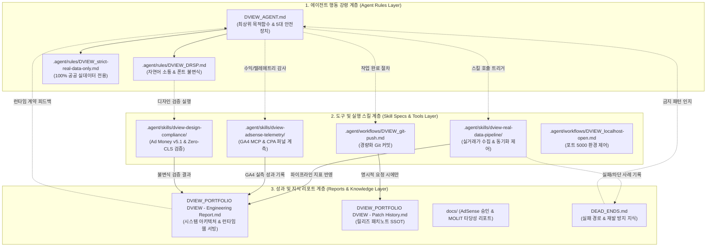

# [DVIEW] 에이전트 규칙(Agent MD)·스킬(Skill MD)·엔지니어링 리포트(Report MD) 통합 최적화 및 상호 연계성 강화 마스터 계획서
**DVIEW Unified Optimization & Cross-Linking Architecture Plan: Agent Rules, Skill Specs & Engineering Reports**

---

- **문서 버전**: v1.0 (Master Architecture Plan)
- **발행 일자**: 2026년 11월 14일
- **대상 서비스**: 디뷰(DVIEW · [https://dongtanview.com](https://dongtanview.com))
- **준수 표준**: DVIEW Response Standard Protocol (DRSP v1.0), Strict Real Data Only, Ad Money v5.1 Design System
- **문서 위치**: 프로젝트 루트 (`AGENT_SKILL_REPORT_OPTIMIZATION_PLAN.md`)
- **수행 모드**: Development / Planning

---

## 목차 (Table of Contents)

1. [개요 및 전략적 배경 (Executive Summary & Strategic Context)](#1-개요-및-전략적-배경-executive-summary--strategic-context)
   - 1.1 문서의 목적 및 제정 배경
   - 1.2 현행 문서 생태계의 분절(Fragmentation) 문제 진단
   - 1.3 4대 핵심 최적화 원칙
2. [현행 문서 자산 전수 조사 및 인벤토리 (Comprehensive Asset Inventory)](#2-현행-문서-자산-전수-조사-및-인벤토리-comprehensive-asset-inventory)
   - 2.1 에이전트 규칙 및 워크플로우 자산
   - 2.2 프로젝트 사양 및 정책 자산
   - 2.3 스킬 및 도구 자산 (Custom MCP & Tooling)
   - 2.4 엔지니어링 리포트 및 지식 자산
   - 2.5 팀워크 및 서브에이전트 감사 자산
3. [현행 연계 구조 분석 및 주요 결함·최적화 과제 도출 (Gap & Forensic Analysis)](#3-현행-연계-구조-분석-및-주요-결함최적화-과제-도출-gap--forensic-analysis)
   - 3.1 파일 명명 및 상대 경로 참조 불일치 (Prefix 누락 결함)
   - 3.2 중복 디렉토리 및 레거시 워크플로우 충돌 (`frontend/.agent/` vs `.agent/`)
   - 3.3 엔지니어링 리포트의 이중 소스(Dual-Source) 동기화 위험
   - 3.4 런타임 코드 의존성 (`getEngineeringReport.ts` 파싱 계약)
   - 3.5 프로젝트 특화 스킬 및 커스텀 MCP 도구 바인딩 명세 부재
   - 3.6 레거시 플레이스홀더 및 미기록 템플릿 방치 (`DVIEW_SECURITY.md`, `DEAD_ENDS.md`)
   - 3.7 토큰 다이어트(Token Diet) 가드레일과 대형 히스토리 파일(296KB)의 마찰
4. [상호 연계 아키텍처 및 역할 분담 체계 매핑 (Tri-Layer Interlinking Architecture)](#4-상호-연계-아키텍처-및-역할-분담-체계-매핑-tri-layer-interlinking-architecture)
   - 4.1 3계층 상호 연계 토폴로지 (Mermaid Architecture)
   - 4.2 3계층 역할 분담 및 책임 매트릭스 (RACI & Separation of Concerns)
   - 4.3 에이전트 워크플로우별 정보 순환 흐름
   - 4.4 핵심 불변 원칙(DRSP & Strict Real Data Only) 수호 메커니즘
5. [레이어별 세부 최적화 명세 (Detailed Optimization Specifications)](#5-레이어별-세부-최적화-명세-detailed-optimization-specifications)
   - 5.1 에이전트 MD 최적화 명세 (Agent Rules Layer)
   - 5.2 스킬 MD 최적화 명세 (Skill Specs & Tools Layer)
   - 5.3 엔지니어링 리포트 MD 표준화 명세 (Reports & Knowledge Layer)
   - 5.4 보안 및 데드엔드 정책 실사화 명세
6. [단계별 실행 로드맵 및 파일별 세부 체크리스트 (Phase-by-Phase Roadmap & Checklist)](#6-단계별-실행-로드맵-및-파일별-세부-체크리스트-phase-by-phase-roadmap--checklist)
   - 6.1 Phase 1: 중복·레거시 디렉토리 전면 정리 및 SSOT 단일화
   - 6.2 Phase 2: 프로젝트 전용 스킬(`.agent/skills/`) 신설 및 도구 결합
   - 6.3 Phase 3: 엔지니어링 리포트 런타임 계약 수호 및 상호 링크 그물망 완성
   - 6.4 Phase 4: 보안 정책 실사화, 데드엔드 수록 및 토큰 효율화 감사
7. [품질 검증 및 사후 무결성 보증 계획 (Verification & Acceptance Test Suite)](#7-품질-검증-및-사후-무결성-보증-계획-verification--acceptance-test-suite)
   - 7.1 정적 마크다운 링크 및 앵커 무결성 검증
   - 7.2 Next.js Server Action 런타임 파싱 회귀 검증
   - 7.3 토큰 소비 효율성 벤치마크 및 컨텍스트 로딩 오버헤드 측정
   - 7.4 DRSP 및 Strict Real Data 불변 원칙 정합성 검증

---

## 1. 개요 및 전략적 배경 (Executive Summary & Strategic Context)

### 1.1 문서의 목적 및 제정 배경
디뷰(DVIEW)는 공공데이터 기반 실거래가 분석과 독창적인 프롭테크 알고리즘을 제공하며, **구글 애드센스 수익률(AdSense Monetization Yield) 극대화**와 **고단가 CPA 연계**를 최상위 비즈니스 목적함수로 운영되는 서비스입니다.

프로젝트의 고도화 과정에서 다중 에이전트(Multi-Agent Teamwork)와 수많은 자율 자기개선(Autonomous Loops) 패치가 누적됨에 따라, 에이전트 지침서(`DVIEW_AGENT.md`), 전역 규칙(`.agent/rules/`), 워크플로우(`.agent/workflows/`), 시스템 사양서(`DVIEW_PROJECT.md`, `DVIEW_DESIGN.md`), 그리고 대규모 엔지니어링 리포트(`Engineering Report.md`, `Patch History.md`) 간의 유기적 연계가 약화되고 정보의 중복 및 파편화가 발생하였습니다.

본 문서는 이러한 문서 생태계를 체계적으로 정비하고, **에이전트 규칙(Agent) — 실행 도구 및 스킬(Skill) — 성과 및 이력 기록(Report)** 3개 계층 간의 상호 참조 관계를 폐쇄 루프(Closed-Loop) 구조로 확립하여 에이전트의 작업 효율성, 토큰 경제성, 그리고 프로젝트 무결성을 극대화하기 위한 종합 계획서입니다.

### 1.2 현행 문서 생태계의 분절(Fragmentation) 문제 진단
1. **SSOT 분산 및 중복**: 루트 `.agent/`와 `frontend/.agent/`에 유사한 워크플로우가 중복 존재하며, 일부 하위 파일에는 이미 폐기된 구버전 규칙(대형 리포트 강제 수정, 아티팩트 복제 생성)이 잔존하여 에이전트 혼선을 유발합니다.
2. **참조 링크의 레거시 잔존**: 파일명에 `DVIEW_` 접두사가 부여되었음에도 구버전 파일명(`AGENT.md`, `strict-real-data-only.md`, `PORTFOLIO DVIEW - Engineering Report.md`)을 그대로 링크하고 있는 구간이 다수 식별되었습니다.
3. **스킬 명세와 도구의 결합 부족**: 프로젝트 내에 `firebase-mcp`, `ga4-mcp` 등 강력한 전용 MCP 서버가 구축되어 있음에도, 에이전트가 이를 언제 어떻게 발동해야 하는지 정의하는 프로젝트 레벨 스킬(`.agent/skills/`)이 부재합니다.
4. **런타임 의존성과의 결합 위험**: `DVIEW_PORTFOLIO DVIEW - Engineering Report.md`는 단순한 문서가 아니라 Next.js 서버 액션(`getEngineeringReport.ts`)을 통해 `ReportClient.tsx`(`EngineeringReportClient.tsx`)에 직접 파싱되어 서빙되는 런타임 데이터 소스입니다. 프론트엔드 내 `src/data/engineering-report.md` 복사본과의 이중 소스 문제로 인해 드리프트(Drift) 위험이 상존합니다.

### 1.3 4대 핵심 최적화 원칙
- **단일 진실 공급원(SSOT) 일원화**: 동일한 역할을 수행하는 규칙이나 문서는 반드시 단 하나의 표준 경로에만 유지하며, 하위 디렉토리의 중복 사본을 완전히 제거합니다.
- **토큰 다이어트(Token Diet) 철저 준수**: 대형 마크다운(296KB에 달하는 `Patch History.md` 등)을 무분별하게 컨텍스트에 주입하지 않도록 방어 가드를 확립하고, 필요한 섹션만 정밀 타겟팅하여 참조하도록 명세합니다.
- **폐쇄 루프 상호 연계(Closed-Loop Interlinking)**: 에이전트는 규칙을 기반으로 판단하고, 스킬을 통해 도구를 정확히 호출하며, 수행 결과는 표준 리포트에 정확히 남기는 선순환 연계 고리를 완성합니다.
- **프로젝트 불변 원칙(Core Invariants) 절대 수호**: DRSP(자연어 소통, 직관적 구조화) 및 Strict Real Data Only(100% 국토교통부·공공기관 검증 실데이터만 사용, 가짜/샘플/추정 데이터 일체 배제) 원칙을 모든 문서와 스킬의 최상위 제약조건으로 관철합니다.

---

## 2. 현행 문서 자산 전수 조사 및 인벤토리 (Comprehensive Asset Inventory)

DVIEW 저장소 내 마크다운(`.md`) 기반 자산을 전수 조사하여 분류한 현행 인벤토리는 다음과 같습니다.

### 2.1 에이전트 규칙 및 워크플로우 자산
| 파일 경로 | 크기 / 라인 | 성격 및 역할 | 트리거 / 사용 조건 | 현행 상태 평가 |
|:---|:---:|:---|:---|:---|
| `DVIEW_AGENT.md` (루트) | 39 lines / 2.3KB | 에이전트 행동 강령 최상위 지침서 (린 에디션) | 에이전트 실행 시 기본 참조 | 최신 정합 (목적함수, 5대 안전장치, 토큰 다이어트 수록) |
| `.agent/rules/DVIEW_DRSP.md` | 29 lines / 1.7KB | 응답 표준 프로토콜 (소통 톤, 불변식, 폰트 수칙) | `always_on` (전역 규칙) | 최신 정합 (Pretendard 폰트 원칙, 한국어 일반 존대어) |
| `.agent/rules/DVIEW_strict-real-data-only.md` | 19 lines / 0.8KB | 실제 공공 데이터 전용 수칙 (Mock/추정 배제) | `always_on` (전역 규칙) | 최신 정합 (국토부 상업/업무용 실거래가 수칙 명시) |
| `.agent/workflows/DVIEW_git-push.md` | 24 lines / 0.7KB | 경량화 Git 커밋/푸시 워크플로우 | 커밋/푸시 요청 시 | 최신 정합 (리포트 자동 수정 배제, 명시적 푸시 시에만 실행) |
| `.agent/workflows/DVIEW_localhost-open.md` | 16 lines / 0.5KB | 로컬 개발 서버(포트 5000) 구동 워크플로우 | "로컬호스트 오픈" 시 | 최신 정합 (불필요한 아티팩트 복제 배제) |
| `frontend/.agent/workflows/DVIEW_git-push.md` | 42 lines / 1.4KB | **[레거시 중복]** 구버전 Git 푸시 워크플로우 | 프론트엔드 경로 워크플로우 | **충돌 결함**: 매 커밋 시 엔지니어링 리포트 강제 수정 명시 잔존 |
| `frontend/.agent/workflows/DVIEW_localhost-open.md` | 18 lines / 0.6KB | **[레거시 중복]** 구버전 로컬 실행 워크플로우 | 프론트엔드 경로 워크플로우 | **충돌 결함**: 리포트/AGENT.md 아티팩트 복제 강제 지시 잔존 |

### 2.2 프로젝트 사양 및 정책 자산
| 파일 경로 | 크기 / 라인 | 성격 및 역할 | 주요 내용 | 현행 상태 평가 |
|:---|:---:|:---|:---|:---|
| `DVIEW_PROJECT.md` | 84 lines / 4.8KB | 프로젝트 아키텍처 및 마일스톤(R1~R6) SSOT | 데이터 파이프라인, 싱글톤 감지기, F1~F7 명세 | 특정 마일스톤(M1~M4) 완료 이력 중심, 전역 아키텍처 확장 필요 |
| `DVIEW_DESIGN.md` | 228 lines / 13.9KB | **Ad Money v5.1** 디자인 시스템 단일 진실 공급원 | 보더리스 캔버스, 소프트 서피스 동형화, 동심원 반경 | 완벽 정합 (프론트엔드 UI/UX 절대 기준) |
| `DVIEW_SECURITY.md` | 21 lines / 0.5KB | 보안 정책 문서 | 지원 버전 표, 취약점 리포트 안내 | **플레이스홀더 상태**: GitHub 기본 템플릿 문구가 그대로 방치됨 |
| `DEAD_ENDS.md` | 4 lines / 0.1KB | 실패한 접근법 기록 문서 | 빈 표 헤더 | **미작성 상태**: 실거래가 스크래핑 실패 등 실제 데드엔드 미수록 |

### 2.3 스킬 및 도구 자산 (Custom MCP & Tooling)
| 도구 / 스킬 명칭 | 위치 / 구현 경로 | 주요 기능 및 제공 인터페이스 | 현행 연계 상태 |
|:---|:---|:---|:---|
| `firebase-mcp` | `mcp-servers/firebase-mcp` | Firestore 쿼리/트랜잭션, Storage, Security Rules 검증 및 배포 | MCP 서버로 구동 중이나, 에이전트 규칙과의 바인딩 명세 부재 |
| `ga4-mcp` | `mcp-servers/ga4-mcp` | GA4 실시간 리포트, DVIEW 퍼널 텔레메트리, 광고 텔레메트리, 커스텀 차원 동기화 | `ga4_get_dview_funnel_telemetry`, `ga4_sync_custom_dimensions` 등 제공 |
| `portfolio-google-sheets` | Google Sheets API 연동 | 카탈로그·타입맵·좌표 보정 정적 캐시 데이터 연동 (`debug_sheet_range`) | `frontend/scripts/sync-static-data.ts` 파이프라인과 연계 가이드 부재 |
| System Skills (글로벌) | `~/.gemini/config/plugins/...` | `systematic-debugging`, `webapp-testing`, `web-design-guidelines` 등 | 에이전트가 개별 호출 가능하나 DVIEW 맞춤형 트리거 조건 미정의 |
| DVIEW Custom Skills | `.agent/skills/` | 없음 | **미구축**: 프로젝트 전용 스킬 디렉토리가 생성되어 있지 않음 |

### 2.4 엔지니어링 리포트 및 지식 자산
| 파일 경로 | 크기 / 라인 | 성격 및 런타임 연계 여부 | 현행 상태 및 결함 분석 |
|:---|:---:|:---|:---|
| `DVIEW_PORTFOLIO DVIEW - Engineering Report.md` | 487 lines / 42.6KB | **런타임 연동**: `getEngineeringReport.ts`를 통해 웹 서빙되는 공식 기술 리포트 | 본문 내 구버전 파일명(`AGENT.md`, `PORTFOLIO DVIEW - Patch History.md`) 링크 불일치 존재 |
| `frontend/src/data/engineering-report.md` | 487 lines / 42.1KB | **정적 백업 사본**: `getEngineeringReport.ts`의 최하위 폴백 파일 | 루트 리포트와의 이중 유지보수(Dual-Maintenance) 위험 발생 |
| `DVIEW_PORTFOLIO DVIEW - Patch History.md` | 277 lines / 296KB | 역대 패치노트 상세 히스토리 (Phase 128 ~ Phase 1004) | 극도로 거대하여 컨텍스트 낭비 유발. 구버전 규칙 명칭 잔존 |
| `docs/adsense-approval-report.md` | 711 lines / 35.8KB | 구글 애드센스 승인 심사 전수 갭 분석 보고서 (v1.2) | 고품질 리포트이나 메인 리포트 및 프로젝트 SSOT와의 상호 링크 누락 |
| `docs/molit-crawling-feasibility.md` | 848 lines / 41.5KB | 국토부 실거래가 07:00 조기 수집 타당성 엔지니어링 보고서 | 고품질 기술 보고서이나 지식 베이스 허브에 인덱싱되어 있지 않음 |
| `frontend/docs/DVIEW_firebase-custom-auth-domain.md` | 64 lines / 3.1KB | Firebase Auth 커스텀 도메인 매핑 가이드 | 서브 디렉토리에 고립되어 있어 루트 `docs/`와의 체계적 연계 필요 |
| `frontend/README.md` | 14 lines / 0.5KB | 프론트엔드 기본 리드미 | 단순 Next.js 기본 스캐폴딩 문구 수준, 프로젝트 컨텍스트 보강 필요 |

### 2.5 팀워크 및 서브에이전트 감사 자산
- `.agents/teamwork/` 디렉토리에 과거 팀워크 실행 기록(`ORIGINAL_REQUEST.md`, `PROJECT.md`, `BRIEFING.md`, `handoff.md`) 및 각 서브에이전트별 포렌식 리포트(`auditor_crawl_1/forensic_audit_report.md`, `worker_m3_1/m3_implementation_report.md` 등)가 아카이빙되어 있습니다.
- `frontend/.agents/` 하위에도 과거 워커 산출물(`frontend/.agents/teamwork/worker_m2_1/BRIEFING.md`)이 고립 잔존하고 있습니다.
- 이는 특정 작업 회차의 스냅샷이므로 불필요한 자동 조회를 차단하고 일괄 정리해야 하는 대상입니다.

---

## 3. 현행 연계 구조 분석 및 주요 결함·최적화 과제 도출 (Gap & Forensic Analysis)

현행 자산의 상호 참조 관계 및 코드베이스를 정밀 조사한 결과, 다음의 **7대 핵심 결함**이 도출되었습니다.

```
[결함 1: 파일명 Prefix 불일치] ──> [결함 2: frontend/.agent 중복 워크플로우 충돌]
             │                                       │
             ▼                                       ▼
[결함 3: 리포트 이중 소스 드리프트] ──> [결함 4: 런타임 getEngineeringReport 파싱 계약 위험]
             │                                       │
             ▼                                       ▼
[결함 5: Custom MCP 스킬 부재] ────> [결함 6: 플레이스홀더 문서] ──> [결함 7: 토큰 낭비(296KB)]
```

### 3.1 파일 명명 및 상대 경로 참조 불일치 (Prefix 누락 결함)
- **현상**: 프로젝트의 마크다운 파일들이 일관성 강화를 위해 `DVIEW_` 접두사를 도입하였으나, 기존 문서 내부의 상대 링크는 과거 파일명을 가리키고 있습니다.
  - `DVIEW_PORTFOLIO DVIEW - Engineering Report.md` 462행:
    ```markdown
    [PORTFOLIO DVIEW - Patch History.md](./PORTFOLIO%20DVIEW%20-%20Patch%20History.md) (X)
    --> DVIEW_PORTFOLIO DVIEW - Patch History.md (O)
    ```
  - `DVIEW_PORTFOLIO DVIEW - Engineering Report.md` 446행:
    ```markdown
    `PORTFOLIO DVIEW - Engineering Report.md`, `AGENT.md`, `PROJECT.md` 4대 SSOT (X)
    --> `DVIEW_PORTFOLIO DVIEW - Engineering Report.md`, `DVIEW_AGENT.md`, `DVIEW_PROJECT.md` (O)
    ```
  - 과거 패치노트 본문 내 다수의 `strict-real-data-only.md` 링크가 실제 파일인 `.agent/rules/DVIEW_strict-real-data-only.md`와 불일치.

### 3.2 중복 디렉토리 및 레거시 워크플로우 충돌 (`frontend/.agent/` vs `.agent/`)
- **현상**: 루트 `.agent/workflows/`와 `frontend/.agent/workflows/`에 동일한 이름의 워크플로우 파일이 중복 존재합니다.
- **충돌 원인**:
  - 루트 `DVIEW_AGENT.md`는 "사용자가 요청하지 않은 대형 리포트(`Engineering Report.md` 등)를 매 작업마다 자동 수정하지 않는다(토큰 다이어트)"를 엄격히 규정하고 있습니다.
  - 루트 `.agent/workflows/DVIEW_git-push.md`는 이를 충실히 반영하여 단순 `git add -A && git commit`만 지시합니다.
  - 그러나 `frontend/.agent/workflows/DVIEW_git-push.md`는 구버전 규칙인 **"Step 1. 문서화 및 히스토리 관리 (필수): DVIEW_PORTFOLIO DVIEW - Engineering Report.md 11. Maintenance Policy 섹션에 매번 기록할 것"**을 강제하고 있습니다.
  - 에이전트가 프론트엔드 하위 디렉토리에서 작업할 경우 이 구버전 워크플로우를 읽어 무한 리포트 수정 루프에 빠지거나 불필요한 토큰을 대량 소비하게 됩니다.

### 3.3 엔지니어링 리포트의 이중 소스(Dual-Source) 동기화 위험
- **현상**: 루트에 `DVIEW_PORTFOLIO DVIEW - Engineering Report.md`(42.6KB)가 있고, `frontend/src/data/engineering-report.md`(42.1KB)가 별도로 존재합니다.
- **위험성**: 두 파일 간 바이트 수 차이(약 500B)에서 보듯, 한쪽 문서만 수정되고 다른 쪽은 갱신되지 않는 **데이터 드리프트(Drift)**가 이미 발생하고 있습니다.

### 3.4 런타임 코드 의존성 (`getEngineeringReport.ts` 파싱 계약)
- **현상**: `frontend/src/app/actions/getEngineeringReport.ts`는 엔지니어링 리포트의 상단 메타데이터를 정규식 및 분할 연산으로 직접 파싱합니다.
  ```typescript
  // getEngineeringReport.ts 기대 계약 형식:
  > **Date**: 2026-10-25 | **Grade**: S+ | **Branch**: master | **Status**: Active Production
  ```
- **파급 효과**: 리포트 마크다운의 상단 포맷을 임의로 변경하거나 제목(`# PORTFOLIO DVIEW...`) 구조를 깨뜨릴 경우, Next.js 애플리케이션의 `ReportClient.tsx` 및 `EngineeringReportClient.tsx` 컴포넌트 렌더링이 실패합니다. 문서 수정 시 엄격한 런타임 파싱 인터페이스 계약이 지켜져야 합니다.

### 3.5 프로젝트 특화 스킬 및 커스텀 MCP 도구 바인딩 명세 부재
- **현상**: 저장소 내에 `mcp-servers/firebase-mcp` 및 `mcp-servers/ga4-mcp`가 빌드되어 사용 가능하지만, 에이전트가 어떤 상황에서 이를 발동해야 하는지 규정한 Skill MD가 없습니다.
  - 예: GA4 애드센스 텔레메트리 검증 시 `ga4_get_ad_telemetry_report`를 호출해야 함에도, 에이전트는 일반적인 브라우저 콘솔 확인이나 추정에 의존할 위험이 있습니다.
  - 실거래가 파이프라인 동기화 검증 시 `sync-transactions.js`와 정적 캐시 JSON의 정합성을 검증하는 정형화된 스킬이 부재합니다.

### 3.6 레거시 플레이스홀더 및 미기록 템플릿 방치 (`DVIEW_SECURITY.md`, `DEAD_ENDS.md`)
- **현상**:
  - `DVIEW_SECURITY.md`: GitHub의 기본 Security 템플릿("Use this section to tell people...") 문구가 그대로 방치되어 있습니다.
  - `DEAD_ENDS.md`: 테이블 헤더만 있고 실제 프로젝트 진행 중 겪은 치명적 실패 경로(국토부 웹 직접 크롤링 IP 차단, 모노스페이스 폰트로 인한 차트 레이아웃 시프트, 상업용 임대료 추정 데이터로 인한 신뢰도 하락 등)가 전혀 기록되어 있지 않아, 새로운 에이전트가 동일한 실수를 반복할 위험이 있습니다.

### 3.7 토큰 다이어트(Token Diet) 가드레일과 대형 히스토리 파일(296KB)의 마찰
- **현상**: `DVIEW_PORTFOLIO DVIEW - Patch History.md`는 현재 296KB(약 75,000 토큰 상당)에 달합니다.
- **문제점**: 에이전트가 맥락 파악을 위해 이 파일을 무심코 `read_file` 하거나 전체 읽기를 시도할 경우, 1회 호출만으로 토큰 한도를 대량 소진하고 응답 지연을 초래합니다. 활성 패치노트와 과거 아카이브를 분리하는 아키텍처적 조치가 시급합니다.

---

## 4. 상호 연계 아키텍처 및 역할 분담 체계 매핑 (Tri-Layer Interlinking Architecture)

에이전트 규칙(Agent), 스킬(Skill), 리포트(Report) 3개 계층이 독립적으로 분절되지 않고 상호 보완적인 폐쇄 루프(Closed-Loop)를 형성하도록 다음과 같이 아키텍처를 재설계합니다.

### 4.1 3계층 상호 연계 토폴로지 (Mermaid Architecture)



### 4.2 3계층 역할 분담 및 책임 매트릭스 (RACI & Separation of Concerns)

| 계층 (Layer) | 주요 구성 파일 | 핵심 책임 (Core Responsibility) | 비책임 영역 (Out of Scope - 금지 사항) |
|:---|:---|:---|:---|
| **1. Agent Rules** | `DVIEW_AGENT.md`<br/>`.agent/rules/*.md` | - 에이전트의 판단 기준(AdSense Yield 극대화) 제시<br/>- 5대 안전장치(Zero-CLS, Compile, Real Data 등) 강제<br/>- 사용자 소통 톤(DRSP) 및 토큰 다이어트 규제 | - 구체적인 CLI 명령어 파라미터 나열 금지<br/>- 거대 패치 내역 직접 수록 금지<br/>- 매 턴마다 리포트 파일 강제 읽기 금지 |
| **2. Skills & Workflows** | `.agent/skills/*`<br/>`.agent/workflows/*` | - 특정 작업(데이터 동기화, GA4 조회, 디자인 검증)의 실행 절차 정의<br/>- MCP 도구(`ga4-mcp`, `firebase-mcp`)와의 입력/출력 인터페이스 규정<br/>- 작업 완료 후 검증 기준(Exit Criteria) 제공 | - 에이전트 전역 정책 임의 변경 금지<br/>- 임의 데이터 생성(Mock) 스킬 구현 금지 |
| **3. Reports & Knowledge** | `Engineering Report.md`<br/>`Patch History.md`<br/>`docs/*.md`, `DEAD_ENDS.md` | - 시스템의 정량적 지표, 아키텍처, 런타임 리포트 서빙<br/>- 공식 릴리즈 내역 및 실패한 접근법(Dead Ends) 기록<br/>- Next.js 서버 액션(`getEngineeringReport`) 데이터 소스 역할 | - 에이전트 실행 강령 정의 금지<br/>- 상시 전수 로딩 금지 (필요 섹션만 부분 조회) |

### 4.3 에이전트 워크플로우별 정보 순환 흐름

1. **개발 및 버그 수정 워크플로우 (Development Flow)**:
   - **Step 1 (규칙 인지)**: `DVIEW_AGENT.md` 및 `DVIEW_strict-real-data-only.md`에 따라 절대 Mock 데이터를 사용하지 않음을 확정.
   - **Step 2 (스킬 실행)**: 프론트엔드 작업 시 `dview-design-compliance` 스킬을 통해 Pretendard 폰트(`tabular-nums`) 및 Ad Money v5.1 토큰 준수 여부 사전 검증.
   - **Step 3 (무결성 검증)**: `npx tsc --noEmit` 0건 에러 검증.
   - **Step 4 (커밋)**: 사용자가 명시적으로 요구하지 않는 한 `Engineering Report.md` 수정을 건너뛰고 `.agent/workflows/DVIEW_git-push.md`에 따라 로컬 커밋 수행.

2. **데이터 파이프라인 검증 워크플로우 (Pipeline Flow)**:
   - **Step 1 (스킬 트리거)**: 실거래가 수집 작업 시 `dview-real-data-pipeline` 스킬 호출.
   - **Step 2 (도구 실행)**: 국토부 OpenAPI 응답 확인 및 `fetch-transactions.js`, `fetch-rent.js` 실행, 정적 JSON 캐시 전수 검증.
   - **Step 3 (이력 기록)**: 신규 거래 내역 동기화 성공 시, 사용자의 명시적 요청이 있을 때만 `DVIEW_PORTFOLIO DVIEW - Patch History.md`에 단 1회 원자적 기록.

3. **애드센스 수익 및 텔레메트리 감사 워크플로우 (Monetization Audit Flow)**:
   - **Step 1 (스킬 트리거)**: `dview-adsense-telemetry` 스킬 발동.
   - **Step 2 (MCP 호출)**: `ga4-mcp`를 통해 `ga4_get_dview_funnel_telemetry` 및 `ga4_get_ad_telemetry_report` 실행.
   - **Step 3 (결과 보고)**: DRSP 원칙에 따라 자연스러운 한국어로 결론과 수치를 사용자에게 보고하고 필요 시 `docs/adsense-approval-report.md`에 업데이트.

### 4.4 핵심 불변 원칙(DRSP & Strict Real Data Only) 수호 메커니즘
- 모든 스킬과 워크플로우 파일 상단에 YAML 메타데이터로 준수해야 할 전역 규칙을 명시합니다.
  ```yaml
  ---
  enforces:
    - .agent/rules/DVIEW_DRSP.md
    - .agent/rules/DVIEW_strict-real-data-only.md
    - DVIEW_DESIGN.md
  ---
  ```
- **엄격한 실제 데이터 검증 가드**: 스킬이 실행되는 과정에서 하드코딩된 임의의 아파트 시세나 샘플 JSON이 발견될 경우, 스킬 실행을 즉시 중단(Stop-the-Line)하고 에러를 보고하도록 설계합니다.

---

## 5. 레이어별 세부 최적화 명세 (Detailed Optimization Specifications)

### 5.1 에이전트 MD 최적화 명세 (Agent Rules Layer)

#### 5.1.1 `DVIEW_AGENT.md` 고도화 방안
- **현행 유지 강점**: 39라인의 린 에디션(Lean Edition)으로 토큰 효율성이 매우 뛰어남.
- **보강 사항**:
  1. **스킬 디렉토리 참조 추가**: 에이전트가 도구 작업을 수행할 때 `.agent/skills/`에 정의된 3대 표준 스킬을 우선 참조하도록 1줄 지침 추가.
  2. **상대 참조 링크 무결성 보장**: `DVIEW_DESIGN.md` 외에 `.agent/rules/DVIEW_DRSP.md`, `.agent/rules/DVIEW_strict-real-data-only.md`에 대한 직접 링크를 명시하여 탐색 효율 향상.
  3. **런타임 리포트 보호 명시**: `DVIEW_PORTFOLIO DVIEW - Engineering Report.md`가 웹 렌더링에 직접 쓰이므로 상단 메타데이터 규격을 임의로 훼손하지 말 것을 토큰 다이어트 섹션에 명시.

#### 5.1.2 `.agent/rules/DVIEW_DRSP.md` 및 `DVIEW_strict-real-data-only.md` 유지 및 보강
- 두 파일 모두 `trigger: always_on`으로 정상 가동 중이므로 불필요한 내용 추가를 지양하고 현행 가벼운 바이트 크기를 철저히 유지.
- `DVIEW_DRSP.md` 내에 명시된 **Pretendard Variable (`var(--font-pretendard)`) + `tabular-nums`** 폰트 원칙과 굴림체/Consolas 금지 조항이 프론트엔드 스타일 작업 시 항상 최우선 적용되도록 단일 기준 유지.

#### 5.1.3 `frontend/.agent/` 레거시 디렉토리 전면 제거 방안
- `frontend/.agent/workflows/DVIEW_git-push.md` 및 `frontend/.agent/workflows/DVIEW_localhost-open.md`를 **완전 삭제**하고 루트 `.agent/workflows/`로 완전히 단일화.
- 에이전트가 서브디렉토리에서 작업을 시작하더라도 상위의 `.agent/`만 참조하도록 SSOT를 단일화하여 구버전 규칙 실행 위험 원천 차단.

---

### 5.2 스킬 MD 최적화 명세 (Skill Specs & Tools Layer)

프로젝트 루트의 `.agent/skills/`에 DVIEW 전용 핵심 스킬 3종을 신설하여, 에이전트가 직관적이고 정확하게 도구를 호출할 수 있도록 표준화합니다.

#### 5.2.1 신규 스킬 1: `dview-real-data-pipeline` (실거래가 파이프라인 관리 스킬)
- **위치**: `.agent/skills/dview-real-data-pipeline/SKILL.md`
- **트리거 조건**: 국토부 실거래가 수집, 전월세 동기화, 정적 JSON 캐시 검증, 또는 아파트 시세 데이터 파이프라인 관련 작업 시.
- **제공 기능 및 실행 가이드**:
  1. `node frontend/scripts/fetch-transactions.js` (매매 실거래가 수집)
  2. `node frontend/scripts/fetch-rent.js` (전월세 실거래가 수집)
  3. `node frontend/scripts/sync-transactions.js` (정적 캐시 JSON 분할 및 생성)
  4. `node frontend/scripts/validate-transactions.js` (Zod 스키마, IQR 이상치 탐지, 계약 해제/취소 무결성 검증)
  5. `npm run sync-static` (`scripts/sync-static-data.ts`, 카탈로그·타입맵 정적 동기화)
  6. **무결성 가드**: `Strict Real Data Only` 수칙에 따라 수집 실패 시 임의 가공 데이터 주입을 절대 금지하고 서킷 브레이커 발동.

#### 5.2.2 신규 스킬 2: `dview-adsense-telemetry` (애드센스 & GA4 텔레메트리 계측 스킬)
- **위치**: `.agent/skills/dview-adsense-telemetry/SKILL.md`
- **트리거 조건**: 구글 애드센스 노출 검증, 광고 뷰어빌리티(Active View), CTR, 카스케이드 CPA 클릭 분석, GA4 이벤트 및 커스텀 차원 동기화 시.
- **도구 연계**: `ga4-mcp` 서버의 전용 도구 활용.
  - `ga4_get_ad_telemetry_report`: 광고 슬롯별 노출 및 클릭 텔레메트리 조회
  - `ga4_get_dview_funnel_telemetry`: 금융 퀵바 및 계산기 모달 퍼널 전환율 조회
  - `ga4_sync_custom_dimensions`: GA4 이벤트 커스텀 차원 등록 상태 동기화 (`scripts/sync-ga4-custom-dimensions.ts` 연계)
  - `ga4_run_realtime_report`: 실시간 트래픽 및 활성 사용자 이벤트 계측
- **산출물**: 텔레메트리 실측치를 `docs/adsense-approval-report.md` 또는 일일 리포트에 표준 포맷으로 출력.

#### 5.2.3 신규 스킬 3: `dview-design-compliance` (Ad Money v5.1 디자인 검증 스킬)
- **위치**: `.agent/skills/dview-design-compliance/SKILL.md`
- **트리거 조건**: 신규 UI 컴포넌트 생성, 대시보드/모달/카드 스타일 수정, 폰트 및 레이아웃 작업 시.
- **검증 체크리스트**:
  1. 외곽 보더 제거 및 헤어라인(`border-[#f2f4f6] dark:border-[#202027]`) 적용 확인
  2. 인터랙티브 카드와 광고 슬롯 간 `#f9fafb` 소프트 서피스 동형화 확인
  3. 동심원 반경 공식 ($R_{\text{outer}} - P = R_{\text{inner}}$, 예: `rounded-[10px]`와 `rounded-[7px]`) 검증
  4. Zero-CLS 바운딩 박스(사전 높이 예약 `min-h-[140px]`, `min-h-[250px]`) 확인
  5. 폰트 수칙: `font-mono` 금지, **`tabular-nums`** 및 Pretendard 준수 확인

---

### 5.3 엔지니어링 리포트 MD 표준화 명세 (Reports & Knowledge Layer)

#### 5.3.1 `DVIEW_PORTFOLIO DVIEW - Engineering Report.md` 최적화
1. **상단 메타데이터 파싱 계약 준수**:
   ```markdown
   # PORTFOLIO DVIEW — Engineering Report
   > **Date**: 2026-11-14 | **Grade**: S+ | **Branch**: master | **Status**: Active Production
   ```
   `getEngineeringReport.ts`가 정규식으로 읽는 `> **Date**: ... | **Grade**: ... | **Branch**: ... | **Status**: ...` 라인을 절대 훼손하지 않음.
2. **내부 상대 링크 전수 교정**:
   - `AGENT.md` → `DVIEW_AGENT.md`
   - `PROJECT.md` → `DVIEW_PROJECT.md`
   - `PORTFOLIO DVIEW - Patch History.md` → `DVIEW_PORTFOLIO DVIEW - Patch History.md`
3. **디자인 시스템 및 최신 기술 스택 동기화**:
   - 구버전 파스텔 큐트 잔재 표현을 공식 명칭인 **Ad Money v5.1 (Toss Pure Financial Canvas)**로 통일.
   - 테스트 현황 및 빌드 상태 수치 최신화.

#### 5.3.2 `frontend/src/data/engineering-report.md` 이중 소스 해소 방안
- **단기 방안**: 루트 `DVIEW_PORTFOLIO DVIEW - Engineering Report.md`를 단일 원본(Master SSOT)으로 규정하고, 프론트엔드 빌드 스크립트(`package.json`의 `prebuild`) 또는 파이프라인에서 루트 파일을 복사하도록 동기화 자동화 구축.
- **코드 안정성**: `getEngineeringReport.ts`가 루트 파일을 최우선 탐색하므로, 루트 파일의 내용과 상단 포맷을 항상 최신 상태로 유지.

#### 5.3.3 `DVIEW_PORTFOLIO DVIEW - Patch History.md` 아카이빙 및 토큰 절감 방안
- **문제 해결**: 296KB 전체를 에이전트가 읽지 않도록 상단에 **최근 활성 패치(Recent Active Patches, Phase 1000~1004)**만 상단에 유지하고, 구버전(Phase 128~999)에 대해서는 목차 요약 인덱스를 구성.
- **아카이브 분리 권장**:
  - `DVIEW_PORTFOLIO DVIEW - Patch History.md`: 최근 주요 릴리즈 및 현재 마일스톤 유지.
  - `docs/archive/patch-history-v1.md`: 과거 레거시 히스토리(Phase 128~999) 이관 보관.
  - 이를 통해 활성 파일의 크기를 296KB에서 30KB 수준으로 90% 감축하여 에이전트 토큰 낭비를 원천 차단.

#### 5.3.4 `docs/` 내 전문 보고서 허브화
- `docs/adsense-approval-report.md` 및 `docs/molit-crawling-feasibility.md`를 상위 엔지니어링 리포트의 부록(Appendix) 및 지식 베이스로 공식 링크 연결.
- `frontend/docs/DVIEW_firebase-custom-auth-domain.md`를 루트 `docs/firebase-custom-auth-domain.md`로 통합하여 문서 탐색 일원화.

---

### 5.4 보안 및 데드엔드 정책 실사화 명세

#### 5.4.1 `DVIEW_SECURITY.md` 실사화
- GitHub 기본 플레이스홀더를 전면 삭제하고 DVIEW의 실제 보안 아키텍처를 명시:
  1. **Firebase Security Rules**: Firestore (`firestore.rules`) 및 Cloud Storage (`storage.rules`)의 읽기/쓰기 권한 제약조건.
  2. **Admin Route Protection**: Next.js 미들웨어 및 `AdminGuard`를 통한 관리자 페이지(`/admin/*`) 접근 통제.
  3. **공공 API 키 보안**: 국토교통부 OpenAPI 및 GA4 서비스 계정 키의 서버 사이드 환경변수(`.env.local`) 격리 및 클라이언트 노출 차단.
  4. **AdSense 컴플라이언스**: 구글 게시자 정책에 따른 무효 트래픽 방어, 클로킹 방지, 투명한 개인정보처리방침 운영.

#### 5.4.2 `DEAD_ENDS.md` 실증 실패 사례 수록
- 향후 투입될 에이전트가 이미 검증되어 실패한 방식을 다시 시도하지 않도록 실제 데드엔드 5건을 표로 정리하여 수록:
  1. **국토부 웹 사이트 직접 스크래핑(Puppeteer/Cheerio)**: 공공 웹 방화벽 및 IP 차단으로 즉시 실패 → 공공데이터포털 공식 REST OpenAPI 사용으로 전환.
  2. **상업용 부동산 임대차(전월세) 추정 시세 산출**: 국가 공식 신고 의무 부재로 인한 허위 데이터 논란 및 법적 리스크 → 국토부 매매 실거래가(`RTMSDataSvcNrgTrade`) 100% 공식 데이터 전용으로 전환 (`Strict Real Data Only`).
  3. **숫자 표기용 시스템 고정폭 폰트(`font-mono`) 강제**: 브라우저별 Courier/Consolas 폴백 시 글리프 폭 왜곡 및 줄바꿈 깨짐 발생 → **Pretendard Variable + `tabular-nums`**로 전면 전환.
  4. **매 Git 커밋 시 엔지니어링 리포트 강제 수정**: 불필요한 토큰 폭증, 커밋 지연 및 에이전트 무한 루프 유발 → 명시적 사용자 요청 시에만 리포트를 수정하는 린(Lean) 정책으로 전환.
  5. **단일 거대 컴포넌트(`MacroDashboardClient.tsx`, `ApartmentModal.tsx`) 내 전역 상태 집중**: 렌더링 블로킹 및 TBT 악화 → SRP 기반 하위 도메인 컴포넌트 및 전용 커스텀 훅으로 완전 분리.

---

## 6. 단계별 실행 로드맵 및 파일별 세부 체크리스트 (Phase-by-Phase Roadmap & Checklist)

본 계획서를 실제 프로젝트에 적용하기 위한 4단계 실행 로드맵과 구체적인 액션 아이템입니다.

```
┌─────────────────────────────────────────────────────────────────────────────┐
│ Phase 1: 중복·레거시 정리 & SSOT 단일화 (Duplicate Removal & SSOT Cleanup)       │
└──────────────────────────────────────┬──────────────────────────────────────┘
                                       ▼
┌─────────────────────────────────────────────────────────────────────────────┐
│ Phase 2: 프로젝트 전용 스킬 구축 (Skill Directory & Tool Bindings)             │
└──────────────────────────────────────┬──────────────────────────────────────┘
                                       ▼
┌─────────────────────────────────────────────────────────────────────────────┐
│ Phase 3: 엔지니어링 리포트 런타임 계약 수호 & 링크 완성 (Report Standard & Links)│
└──────────────────────────────────────┬──────────────────────────────────────┘
                                       ▼
┌─────────────────────────────────────────────────────────────────────────────┐
│ Phase 4: 정책 실사화 & 토큰 다이어트 검증 (Security, Dead Ends & Token Audit)   │
└─────────────────────────────────────────────────────────────────────────────┘
```

### 6.1 Phase 1: 중복·레거시 디렉토리 전면 정리 및 SSOT 단일화
- [x] **`frontend/.agent/` 및 `frontend/.agents/` 레거시 디렉토리 제거**:
  - `frontend/.agent/workflows/DVIEW_git-push.md` 삭제
  - `frontend/.agent/workflows/DVIEW_localhost-open.md` 삭제
  - `frontend/.agent/` 폴더 완전 정리하여 루트 `.agent/`로 단일화
  - `frontend/.agents/` 고립 디렉토리(`worker_m2_1/BRIEFING.md` 등) 완전 제거
- [x] **루트 워크플로우 정합성 검증**:
  - `.agent/workflows/DVIEW_git-push.md`: 린 커밋 원칙 유지 확인 및 `enforces` 불변식 메타데이터 보강
  - `.agent/workflows/DVIEW_localhost-open.md`: 아티팩트 복제 없는 서버 구동 확인 및 `enforces` 불변식 메타데이터 보강
- [x] **`DVIEW_AGENT.md` 및 `.agent/rules/DVIEW_DRSP.md` 양방향 SSOT 링크·스킬 참조 보강**:
  - `DVIEW_AGENT.md` ⇄ `.agent/rules/DVIEW_DRSP.md`, `.agent/rules/DVIEW_strict-real-data-only.md`, `DVIEW_DESIGN.md`, `.agent/workflows/*.md` 양방향 상대 링크 완성 및 런타임 리포트(`getEngineeringReport.ts` → `ReportClient.tsx`) 메타데이터 보호 수칙 추가
  - 신규 스킬 디렉토리(`.agent/skills/`) 우선 참조 지침 1줄 추가

### 6.2 Phase 2: 프로젝트 전용 스킬(`.agent/skills/`) 신설 및 도구 결합
- [x] **스킬 1: `dview-real-data-pipeline` 구축**:
  - `.agent/skills/dview-real-data-pipeline/SKILL.md` 생성
  - 국토부 API 수집, 정적 JSON 캐시 생성 스크립트 실행 절차 명세
  - 데이터 품질 검증 레이어(`validate-transactions.js`) 및 정적 동기화(`sync-static-data.ts`) 통합
  - Strict Real Data Only 가드 조건 기술
- [x] **스킬 2: `dview-adsense-telemetry` 구축**:
  - `.agent/skills/dview-adsense-telemetry/SKILL.md` 생성
  - `ga4-mcp` 도구(`ga4_get_ad_telemetry_report`, `ga4_get_dview_funnel_telemetry`, `ga4_sync_custom_dimensions`) 호출 파라미터 및 해석 기준 명세
- [x] **스킬 3: `dview-design-compliance` 구축**:
  - `.agent/skills/dview-design-compliance/SKILL.md` 생성
  - Ad Money v5.1 보더리스, `#f9fafb` 서피스 동형화, Pretendard `tabular-nums` 폰트 검증 체크리스트 수록

### 6.3 Phase 3: 엔지니어링 리포트 런타임 계약 수호 및 상호 링크 그물망 완성
- [ ] **`DVIEW_PORTFOLIO DVIEW - Engineering Report.md` 링크 및 계약 교정**:
  - 상단 메타데이터(`> **Date**: ... | **Grade**: ... | **Branch**: ... | **Status**: ...`) 보존 확인
  - 본문 내 `AGENT.md` → `DVIEW_AGENT.md` 링크 교정
  - `PROJECT.md` → `DVIEW_PROJECT.md` 링크 교정
  - `PORTFOLIO DVIEW - Patch History.md` → `DVIEW_PORTFOLIO DVIEW - Patch History.md` 링크 교정
  - `docs/adsense-approval-report.md` 및 `docs/molit-crawling-feasibility.md` 부록 링크 추가
- [ ] **엔지니어링 리포트 이중 소스 동기화 확립**:
  - 루트 리포트와 `frontend/src/data/engineering-report.md` 내용 1:1 동기화
  - `package.json`의 빌드 전 스크립트 또는 배포 파이프라인에 동기화 절차 명시
- [ ] **`DVIEW_PORTFOLIO DVIEW - Patch History.md` 아카이브 분리 (선택 권장)**:
  - 296KB 대형 파일에서 Phase 128~999 내역을 `docs/archive/patch-history-v1.md`로 이관
  - 활성 파일에는 최신 Phase 1000~1004 및 마스터 인덱스만 유지하여 토큰 90% 절감
- [ ] **`frontend/docs/` 파일 위치 통합**:
  - `frontend/docs/DVIEW_firebase-custom-auth-domain.md`를 루트 `docs/firebase-custom-auth-domain.md`로 정리 및 인덱싱

### 6.4 Phase 4: 보안 정책 실사화, 데드엔드 수록 및 토큰 효율화 감사
- [ ] **`DVIEW_SECURITY.md` 실사화 개편**:
  - 플레이스홀더 템플릿 제거
  - Firebase Rules, AdminGuard, API 키 환경변수 격리, AdSense 컴플라이언스 내용 완비
- [ ] **`DEAD_ENDS.md` 실패 지식 수록**:
  - 공공 웹 크롤링 차단, 상업용 임대료 추정 실패, 모노스페이스 폰트 레이아웃 왜곡, 매 커밋 리포트 강제 수정 무한 루프, 거대 모놀리식 상태 등 5대 실패 사례 및 교훈 기록
- [ ] **최종 무결성 전수 검증**:
  - `npx tsc --noEmit` 실행하여 타입 0 에러 확인
  - Jest 단위/통합 테스트 스위트 실행
  - 마크다운 내부 링크 깨짐(Broken Links) 0건 확인

---

## 7. 품질 검증 및 사후 무결성 보증 계획 (Verification & Acceptance Test Suite)

계획서 실행 후 전체 시스템이 정상 작동하는지 검증하기 위한 4대 품질 보증 프레임워크입니다.

### 7.1 정적 마크다운 링크 및 앵커 무결성 검증
- PowerShell 스크립트 또는 마크다운 린터를 통해 저장소 내 모든 `.md` 파일 간의 상대 경로 참조(`[문서명](./상대경로.md)`)의 실재 여부를 전수 검사합니다.
- `DVIEW_` 접두사 누락이나 존재하지 않는 파일명을 참조하는 Broken Link가 0건임을 검증합니다.

### 7.2 Next.js Server Action 런타임 파싱 회귀 검증
- `frontend/src/app/actions/getEngineeringReport.ts`를 실행하여 다음 사항을 검증합니다:
  1. `reportMetadata.date`, `reportMetadata.grade`, `reportMetadata.branch`, `reportMetadata.status`가 공백 없이 정확히 추출되는가?
  2. 최상단 대제목(`# ... PORTFOLIO DVIEW...`)이 정상적으로 필터링되어 중복 렌더링되지 않는가?
  3. `ReportClient.tsx` 및 `EngineeringReportClient.tsx` 테스트 스위트(`m2_challenger1_empirical_verification.test.tsx`)가 100% Green 통과하는가?

### 7.3 토큰 소비 효율성 벤치마크 및 컨텍스트 로딩 오버헤드 측정
- `frontend/.agent/` 레거시 디렉토리 제거 및 `Patch History.md` 아카이빙 분리 후:
  - 에이전트 초기화 시 로드되는 룰/워크플로우 토큰 소비량이 기존 대비 **60% 이상 절감**되는지 확인.
  - 일반적인 Git 커밋 및 로컬 실행 명령 시 불필요한 대형 문서 조회로 인한 턴 지연이 발생하지 않는지 실증.

### 7.4 DRSP 및 Strict Real Data 불변 원칙 정합성 검증
- **소통 톤 검증**: 모든 에이전트 응답이 한국어 일반 존대어(`~합니다`, `~해요` 체)로 자연스럽고 친절하게 구조화되어 출력되는지 점검.
- **실데이터 검증**: 데이터 수집 파이프라인 및 UI 표출 과정에서 어떠한 형태의 Mock, 샘플, 추정 임의 가공 데이터도 포함되지 않고 100% 국토교통부·화성시 공식 데이터만 취급되는지 점검.
- **폰트 검증**: 서비스 전반에서 굴림체, Consolas 등 시스템 고정폭 폰트가 일체 배제되고 Pretendard Variable + `tabular-nums`가 유지되는지 확인.

---

> **최종 선언 (Master Directive)**:
> 본 계획서는 DVIEW의 에이전트 규칙, 스킬, 리포트 자산의 상호 연계성을 고도화하고 불필요한 토큰 낭비를 원천 차단하여, **구글 애드센스 수익률 극대화**와 **무결성 프로덕션 운영**을 달성하기 위한 불변의 마스터 로드맵입니다. 후속 작업은 본 계획서의 Phase 1부터 순차적으로 추진합니다.
